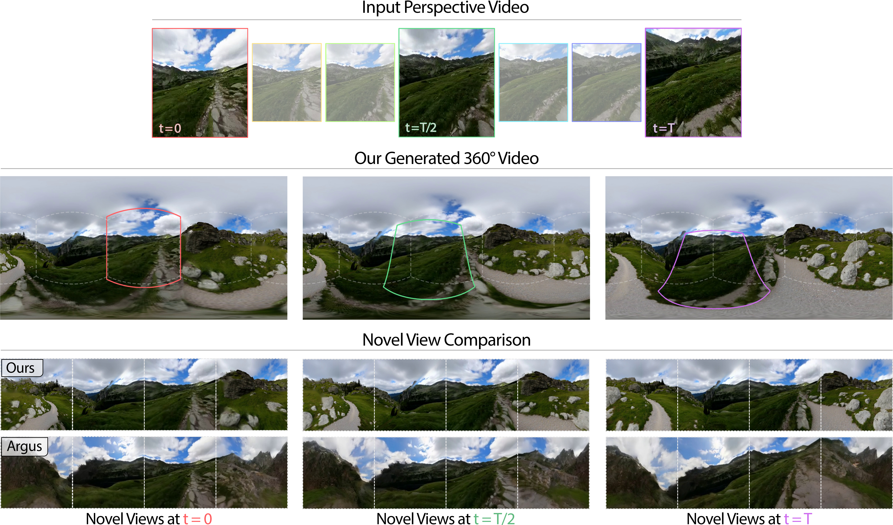

<div align="center">

<h1>A 3D-Driven Framework for Moving-Camera Perspective-to-360° Video Generation</h1>

[**Michael Wakeham**](https://mikewakeham.github.io/) · [**Mrinmoy Kumar Das**](https://mrinmoy.dev/) · [**Wenqi Wang**](https://wqwang.me/)
<br>
[**Ayush Tewari**](https://ayushtewari.com/) · [**Boqing Gong**](https://boqinggong.github.io/) · [**Deepti Ghadiyaram**](https://deeptigp.github.io/)

**WACV 2027**

<a href="https://arxiv.org/abs/2610.25395"></a>
<a href="https://pano3d-video.github.io/"></a>

</div>

<p align="center">
  
</p>


We turn moving-camera perspective videos into 360° videos by combining 3D reconstruction with panoramic image completion. Generated content is anchored in a shared 3D scene and rendered along the camera trajectory, without needing any panoramic-video training.

## Setup

Clone the repository:

```bash
git clone https://github.com/mikewakeham/pano3d-video.git
cd pano3d-video
```

Create and activate the environment:

```bash
conda create -n pano3d-video python=3.10 -y
conda activate pano3d-video
```

Install dependencies:

```bash
python -m pip install torch==2.7.1 torchvision==0.22.1 --index-url https://download.pytorch.org/whl/cu128
python -m pip install setuptools==80.9.0 wheel==0.45.1 ninja==1.13.0
python -m pip install --no-build-isolation -r requirements.txt
```

Accept the access conditions for [FLUX.1-dev](https://huggingface.co/black-forest-labs/FLUX.1-dev), then authenticate with Hugging Face. Model weights will download automatically on first use.

```bash
hf auth login
```

## Example Run

Run the included [example video](assets/0074.mp4) from the `pano3d-video` directory:

```bash
python src/inference.py \
  --input_video assets/0074.mp4 \
  --output_dir outputs/0074 \
  --scene_prompt "This is a panorama image. The photo shows a rocky canyon landscape with large boulders, a shallow riverbed, steep cliffs, patches of grass, and a partly cloudy sky." \
  --fill_video_telea
```

Panoramic and orientation-stabilized videos are saved to `outputs/0074/`. Remove `--fill_video_telea` to disable hole filling; add `--save_splats` to export PLY files. See `python src/inference.py --help` for all options.

## Citation

If you find our work useful, please cite:

```bibtex
@inproceedings{wakeham2027pano3d,
  title={A 3D-Driven Framework for Moving-Camera Perspective-to-360° Video Generation},
  author={Wakeham, Michael and Das, Mrinmoy Kumar and Wang, Wenqi and Tewari, Ayush and Gong, Boqing and Ghadiyaram, Deepti},
  booktitle={Proceedings of the IEEE/CVF Winter Conference on Applications of Computer Vision},
  year={2027}
}
```

## Acknowledgments

Built on [HunyuanWorld-Mirror](https://github.com/Tencent-Hunyuan/HunyuanWorld-Mirror), [DiT360](https://github.com/Insta360-Research-Team/DiT360), [PaGeR](https://github.com/prs-eth/PaGeR), [Depth Anything 3](https://github.com/ByteDance-Seed/Depth-Anything-3), [FLUX.1-dev](https://huggingface.co/black-forest-labs/FLUX.1-dev), [gsplat](https://github.com/nerfstudio-project/gsplat), and [Personalize Anything](https://github.com/fenghora/personalize-anything).

Our original code is [MIT-licensed](LICENSE); third-party code and model weights retain their respective licenses.
